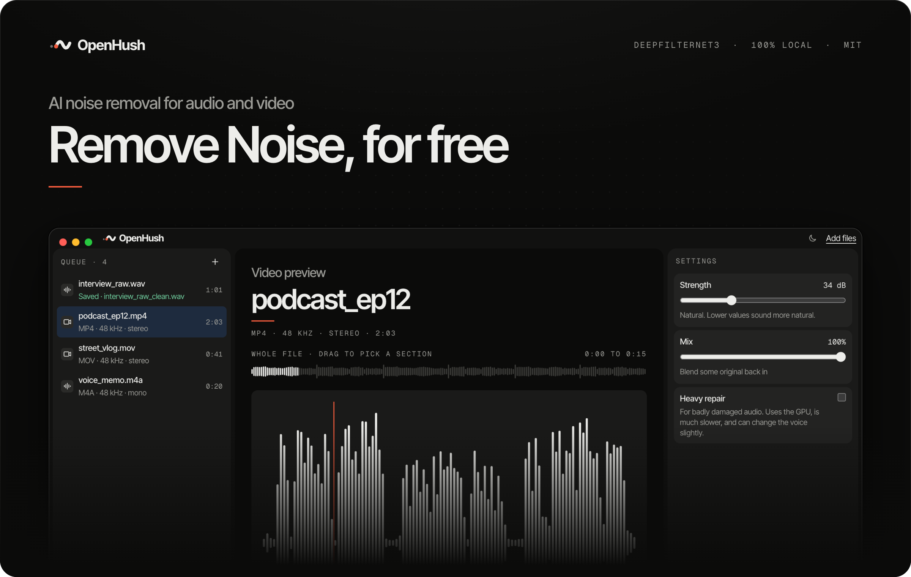
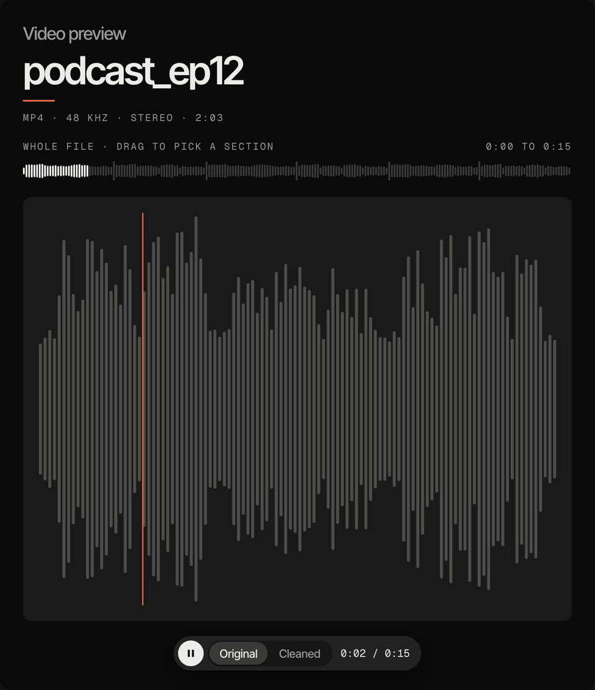
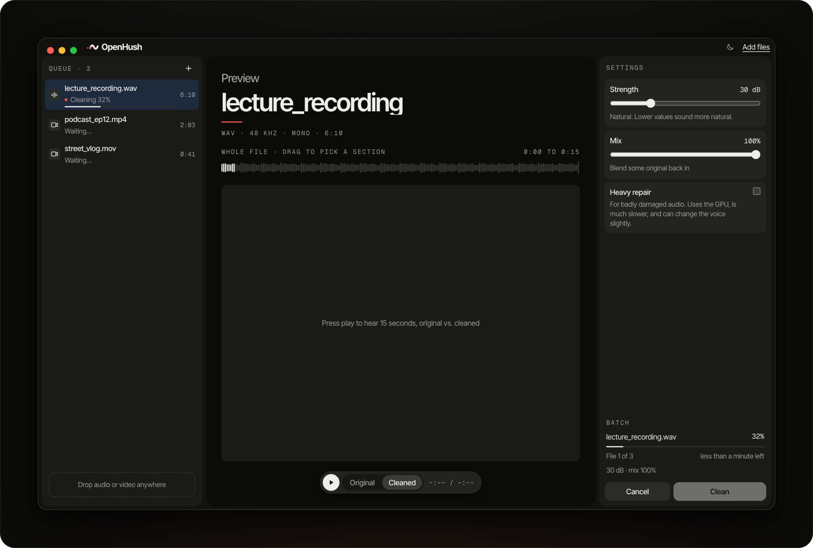

<p align="center">
  <picture>
    <source media="(prefers-color-scheme: dark)" srcset=".github/assets/wordmark-dark.png" />
    
  </picture>
</p>

<p align="center"><b>Local, free AI noise removal for audio and video on macOS.</b></p>

<p align="center">
  Drop in a noisy recording and get back a clean copy, saved right next to the original.<br />
  Everything runs on your Mac with <a href="https://github.com/Rikorose/DeepFilterNet">DeepFilterNet3</a>. No cloud. No account. No subscription.<br />
  Your audio never leaves your machine.
</p>

<p align="center">
  <a href="https://github.com/Akirachang/openhush/releases/latest"></a>
  
  
  
  <a href="LICENSE"></a>
</p>



<p align="center">
  <a href="#-installation"><b>Install</b></a> &nbsp;·&nbsp;
  <a href="#-usage"><b>Usage</b></a> &nbsp;·&nbsp;
  <a href="#-features"><b>Features</b></a> &nbsp;·&nbsp;
  <a href="#-privacy"><b>Privacy</b></a> &nbsp;·&nbsp;
  <a href="#-contributing"><b>Contributing</b></a>
</p>

---

## 📖 Overview

OpenHush is a small desktop app for one job: removing background noise (fans, hum, traffic, room tone, hiss) from speech. You drop files in, listen to a before-and-after preview, pick how hard to clean, and press **Clean**.

It handles video too. The picture is copied bit for bit and only the audio track is replaced, so there's no quality loss and no sync drift. Hour-long files work in constant memory, and nothing you own is ever overwritten.

For recordings that are badly damaged, an optional **Heavy repair** mode uses [Resemble Enhance](https://github.com/resemble-ai/resemble-enhance) on the Apple GPU.

---

## ✨ Features

- **AI noise removal** with DeepFilterNet3, processed at 48 kHz in 32-bit float.
- **Audio and video:** `wav` `mp3` `m4a` `flac` and `mp4` `mov` `mkv`.
- **Untouched video:** the video stream is copied, never re-encoded. Subtitles, extra audio tracks and metadata are kept, and sync is preserved, even for files whose audio starts late.
- **Instant A/B preview:** flip between **Original** and **Cleaned** at the same playhead, with no gap.
- **Strength and Mix:** control how much noise is removed, and blend some of the original back in.
- **Batch processing** with per-file progress, time left, and a **Cancel** that leaves no partial files behind.
- **Safe output:** cleaned copies are saved as `<name>_clean.<ext>`. If that name is taken you get `(2)`, `(3)`, and so on. Originals are never modified.
- **Long files:** hour-long recordings are cleaned in chunks, in constant memory.
- **Heavy repair (optional):** rebuilds badly damaged speech on the Apple GPU.
- **Self-updating:** new versions install with one click, after their checksum and signature are verified.
- **Light and dark mode**, or match the system. On macOS 26 the app icon has light, dark, clear and tinted versions too.

---

## 🚀 Installation

### Requirements

| | |
|---|---|
| **macOS** | Apple Silicon (M1 or later) |
| **ffmpeg** | `brew install ffmpeg` |
| **Disk** | About 350 MB, plus 1.6 GB if you add Heavy repair |

### Install

```bash
brew install ffmpeg      # if you don't have it yet
curl -fsSL https://raw.githubusercontent.com/Akirachang/openhush/main/install.sh | bash
```

The installer downloads the latest release, checks its SHA-256 checksum and code signature, and puts `OpenHush.app` in **Applications** (or `~/Applications` if that isn't writable). Then it opens the app.

On first launch, OpenHush downloads the DeepFilterNet3 engine (28 MB, checked against a pinned SHA-256). After that it works offline.

### Build from source

You need [uv](https://docs.astral.sh/uv/) and Node 22 or later as well.

```bash
git clone https://github.com/Akirachang/openhush.git
cd openhush
npm run setup      # installs the JS and Python dependencies
npm run dist       # builds dist.noindex/mac-arm64/OpenHush.app
```

Then drag `dist.noindex/mac-arm64/OpenHush.app` into **Applications**.

### Uninstall

Delete `OpenHush.app`, then remove `~/Library/Application Support/OpenHush/` and `~/Library/Logs/OpenHush/`.

---

## 💻 Usage

1. **Add files.** Drop files or whole folders anywhere in the window, or press **⌘O**.
2. **Preview.** Select a file, drag the highlight on the whole-file strip to pick a 15-second section, and press **Space** to play.
3. **Compare.** Press **Tab** to flip between **Original** and **Cleaned** at the same moment. **A** and **B** pick a side directly. Click the waveform to jump around.
4. **Adjust.** Set **Strength** and **Mix** in the right panel. Mix is heard live, and the preview re-renders by itself when you change Strength.
5. **Clean.** Press **Clean N files** (**⌘↩**). Double-click a finished file to show it in Finder.

<p align="center">
  
  <br />
  <sub>Switching between Original and Cleaned during playback. The noise floor between words disappears.</sub>
</p>



### Keyboard shortcuts

| Key | Action |
|---|---|
| **Space** | Play or pause the preview |
| **Tab** | Flip between Original and Cleaned |
| **A** / **B** | Hear the Original / the Cleaned version |
| **↑** / **↓** | Select the previous / next file |
| **⌘O** | Add files |
| **⌘↩** | Clean all waiting files |
| **⇧⌘R** | Show the selected file in Finder |
| **⌘⌫** | Remove the selected file from the list |

---

## 🎛️ Settings

| Setting | Range | Default | What it does |
|---|---|---|---|
| **Strength** | 6 to 100 dB | 30 dB | The most noise that can be removed. Lower values sound more natural; higher values are more aggressive. |
| **Mix** | 0 to 100% | 100% | How much of the cleaned signal you hear. Lower it to blend a little of the original room back in. |
| **Heavy repair** | On / off | Off | For very noisy or muffled speech. Uses the GPU and is much slower. The voice can change slightly, so Mix is fixed at 100%. |

The first time you turn on Heavy repair, OpenHush asks before a one-time 1.6 GB download (PyTorch and the model) into its own environment.

---

## 📦 Supported formats

| Type | Extensions | Output |
|---|---|---|
| **Audio** | `wav` `mp3` `m4a` `flac` | Same format, sample rate and channel count as the original |
| **Video** | `mp4` `mov` `mkv` | Video copied as is; the main audio track is cleaned and re-encoded in a matching codec |

Drop a folder and OpenHush picks out the supported files inside it.

---

## 🔄 Updates

OpenHush checks GitHub Releases when it starts and every 6 hours. You can also choose **OpenHush › Check for Updates…**.

1. When a new version is out, a banner shows **OpenHush x.y.z is available**, with **Update** and **What's new**.
2. **Update** downloads it in the background and verifies its SHA-256 checksum, code signature and version.
3. **Restart to update** swaps in the new version and reopens the app. If files are being cleaned, it waits until they're finished.

Settings, the engine and Heavy repair live outside the app bundle, so nothing is downloaded twice.

---

## 🔒 Privacy

**Your audio and video never leave your Mac.** There's no account, no analytics and no telemetry. The engine talks to the app over a private pipe and opens no network port.

These are the only network requests OpenHush ever makes:

| When | Where | What |
|---|---|---|
| First launch | `github.com/Rikorose/DeepFilterNet` | The `deep-filter` engine (28 MB, SHA-256 pinned) |
| At launch and every 6 hours | `api.github.com` | Checks for a newer OpenHush release |
| When you click **Update** | `github.com` | The new version (checksum and signature verified) |
| Only if you install Heavy repair | `pypi.org`, `huggingface.co` | PyTorch, Resemble Enhance and its model weights (SHA-256 pinned), plus Python 3.11 from `github.com` if you don't have it |

---

## 📊 Performance

Measured on an Apple M5 Pro with 24 GB of RAM.

| | |
|---|---|
| **Speed** | A 70-minute stereo file in about 85 seconds (roughly 50× real time) |
| **Memory** | Under 1 GB peak, whatever the file length |
| **Quality** | +11.4 dB SI-SDR on speech mixed with noise at 5 dB SNR |
| **A/V sync** | 0 ms drift, including on a 70-minute video and on audio that starts 0.3 s late |
| **Video** | Video stream MD5 identical before and after |
| **Heavy repair** | About 3× real time on the Apple GPU |

---

## 🏗️ Architecture

```
┌───────────────────────────── OpenHush.app ────────────────────────────┐
│                                                                       │
│  ┌───────────────────────┐   preload API    ┌──────────────────────┐  │
│  │ UI                    │ ◄──────────────► │ Electron main        │  │
│  │ Next.js · React       │   (sandboxed,    │ window · menus       │  │
│  │ Web Audio A/B player  │    isolated)     │ dialogs · updater    │  │
│  └───────────────────────┘                  └──────────┬───────────┘  │
│                                                        │              │
│                         JSON lines over stdin / stdout │              │
│                                                        │              │
│  ┌─────────────────────────────────────────────────────▼───────────┐  │
│  │ Engine (Python, frozen with PyInstaller)                        │  │
│  │                                                                 │  │
│  │  ffmpeg decode ─► 48 kHz float ─► 30 s blocks ─► deep-filter    │  │
│  │  (pipe)                           (parallel)     DeepFilterNet3 │  │
│  │                                                        │        │  │
│  │  ffmpeg encode ◄─ dry/wet mix ◄─ crossfade seams ◄─────┘        │  │
│  │  + remux video (-c:v copy)                                      │  │
│  └─────────────────────────────────────────────────────────────────┘  │
└───────────────────────────────────────────────────────────────────────┘
```

- **Streaming pipeline.** ffmpeg decodes straight into a pipe. Audio is cut into 30-second blocks with a 4-second warm-up, cleaned in parallel by the native `deep-filter` binary, and crossfaded back together, so memory stays flat for any length.
- **Separate engine process.** The engine speaks newline-delimited JSON over stdin/stdout. When the app quits, it cancels its work, stops every child process and exits.
- **Atomic output.** Results are written to a hidden `.partial` file and renamed only when complete, so a cancel or crash never leaves a half-written file.
- **Locked-down UI.** The interface runs sandboxed with context isolation and a strict content security policy. It can reach the engine only through a small preload API.

---

## 📁 Project Structure

```
openhush/
├── engine/                      # Python audio engine
│   ├── openhush_engine/
│   │   ├── pipeline.py          #   decode → chunk → clean → mix → encode / remux
│   │   ├── engine.py            #   runs deep-filter on one block, cancellation
│   │   ├── server.py            #   JSON-lines server the app talks to
│   │   ├── preview.py           #   renders the 15 s Original / Cleaned pair
│   │   ├── heavy.py             #   Heavy repair: install + worker process
│   │   ├── probe.py, peaks.py   #   ffprobe info, whole-file waveform
│   │   └── tools.py, errors.py  #   finds ffmpeg, downloads the engine, friendly errors
│   ├── scripts/                 #   test-media generator, PyInstaller entry point
│   └── tests/                   #   formats, video sync, long files, errors, protocol
├── desktop/                     # Electron main process
│   ├── main.ts                  #   window, menus, IPC, quit handling
│   ├── engine.ts                #   spawns and talks to the engine
│   ├── updater.ts               #   GitHub Releases self-update
│   └── preload.ts               #   the only API the UI can see
├── ui/                          # Next.js static export (the interface)
│   ├── app/                     #   layout, theme tokens (light + dark)
│   ├── components/              #   queue, preview, waveform, transport, settings
│   └── lib/                     #   store, engine bridge, A/B player
├── build/                       # app icon, engine freezing, README image scripts
├── tests/e2e/                   # Playwright tests that drive the real app
├── .github/workflows/release.yml
└── install.sh                   # the one-line installer
```

---

## 🧪 Development

```bash
npm run setup        # once: JS + Python dependencies
npm run dev          # live-reloading UI inside the app
npm start            # build the UI once and open the app
npm run typecheck
```

### Tests

```bash
npm run test:engine                       # formats, video sync, errors, server protocol (~30 s)
(cd engine && uv run pytest -m slow)      # 70-minute files and Heavy repair (~5 min)
npm run test:e2e                          # the real app: add, preview, A/B, clean, cancel, crash recovery
OPENHUSH_APP=dist.noindex/mac-arm64/OpenHush.app npx playwright test   # against the packaged app, plus self-update
```

The noisy test clips are generated on demand by `engine/scripts/make_test_media.py`, from macOS `say` plus synthetic noise.

### App icon

The icon is [`build/OpenHush.icon`](build/OpenHush.icon), an [Icon Composer](https://developer.apple.com/icon-composer/) file with light and dark variants. macOS 26 picks the one that matches **System Settings › Appearance › Icon & widget style**. Release builds compile it with Xcode 26. Local builds without Xcode fall back to the static `build/icon.icns`. The **App icon** workflow renders every variant whenever the icon changes.

### README images

```bash
npm run readme:assets
```

This drives the real app in dark mode to capture the screenshots and the A/B GIF, then frames them into `.github/assets/`. It also writes `social-preview.png` for the repository's social preview (**Settings › General › Social preview**).

---

## 🚢 Releasing

```bash
npm version patch          # or minor / major: bumps package.json and tags vX.Y.Z
git push --follow-tags     # the Release workflow builds and publishes it
```

[`release.yml`](.github/workflows/release.yml) builds `OpenHush.app` on an Apple Silicon runner and publishes `OpenHush-mac-arm64.zip` and its `.sha256` as a GitHub Release, with notes generated from the commits. Installed copies pick it up at their next update check.

---

## ⚠️ Known limitations

- **Signing.** The app is ad-hoc signed, not with an Apple Developer ID. The installer and in-app updates handle this for you. If you download the zip in a browser instead, open the app the first time with right-click › **Open**.
- **Platform.** Apple Silicon only for now.
- **Video.** Only the main (default) audio track is cleaned.
- **Heavy repair** outputs mono, copied to every channel.

---

## 🤝 Contributing

Issues and pull requests are welcome.

1. Fork the repo and create a branch: `git checkout -b feat/my-change`
2. Run `npm run setup`, then `npm run dev` to work on it.
3. Make sure `npm run typecheck`, `npm run test:engine` and `npm run test:e2e` pass.
4. Open a pull request describing what changed and why.

Found a file OpenHush can't handle? Please [open an issue](https://github.com/Akirachang/openhush/issues) with the error message from the app and, if you can, the output of `ffprobe your-file`.

---

## 🙏 Acknowledgments

- [DeepFilterNet](https://github.com/Rikorose/DeepFilterNet) by Hendrik Schröter et al., the model that does the actual cleaning.
- [Resemble Enhance](https://github.com/resemble-ai/resemble-enhance) by Resemble AI, behind Heavy repair.
- [ffmpeg](https://ffmpeg.org), for decoding, encoding and remuxing everything.
- [Electron](https://www.electronjs.org), [Next.js](https://nextjs.org), [Tailwind CSS](https://tailwindcss.com) and [uv](https://github.com/astral-sh/uv).

---

## 📄 License

OpenHush is released under the [MIT License](LICENSE).

It relies on other projects, which keep their own licenses. None of them are stored in this repository:

| Component | License | How OpenHush uses it |
|---|---|---|
| [DeepFilterNet](https://github.com/Rikorose/DeepFilterNet) (code and model weights) | MIT or Apache-2.0 | `deep-filter` binary downloaded on first launch |
| [Resemble Enhance](https://github.com/resemble-ai/resemble-enhance) | MIT | Downloaded only if you install Heavy repair |
| [ffmpeg](https://ffmpeg.org) | LGPL/GPL, depending on the build | Your own installed copy (e.g. Homebrew); not bundled |
| [uv](https://github.com/astral-sh/uv) | MIT or Apache-2.0 | Bundled inside the packaged app to install Heavy repair |
| Electron, Next.js, React, numpy, soundfile and other dependencies | Their own (mostly MIT/BSD) | Installed from npm and PyPI |
